

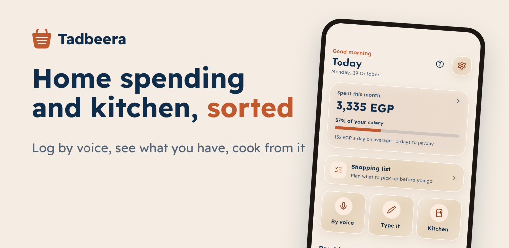

# Tadbeera · تدبيرة

Household spending, kitchen stock and recipes in one app, in Arabic and English.

Tadbeera is a product I designed and built on my own. You record what you buy by voice or by typing, the kitchen keeps itself up to date, and the app suggests recipes from what you already have. Bills, reminders and a monthly recap sit next to your everyday records.

## Screenshots

| | | | |
|:---:|:---:|:---:|:---:|
| 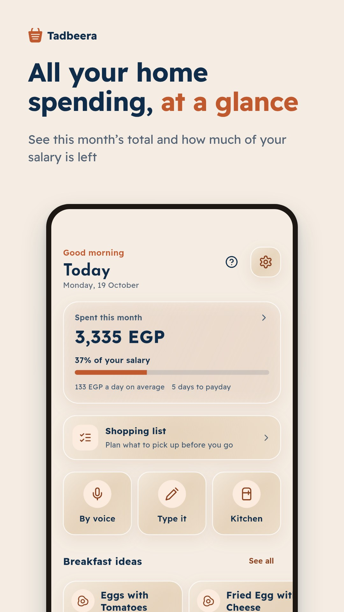 | 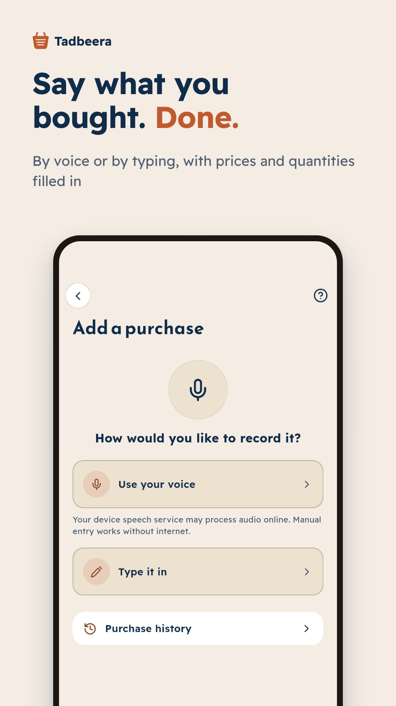 | 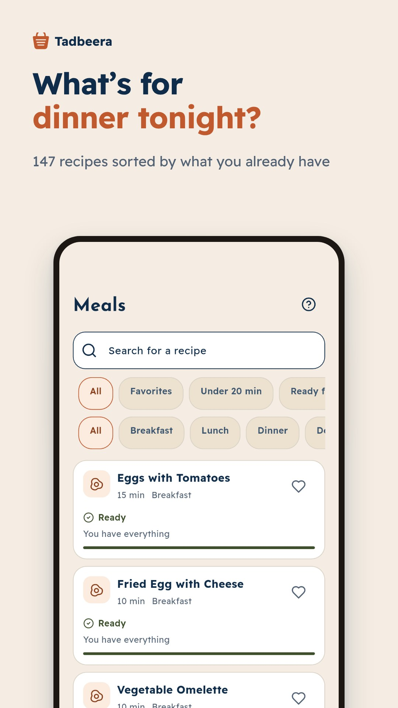 | 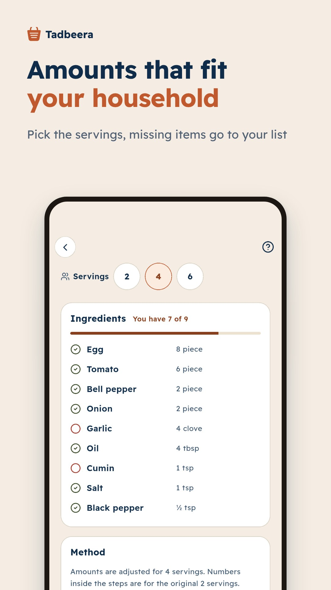 |
| 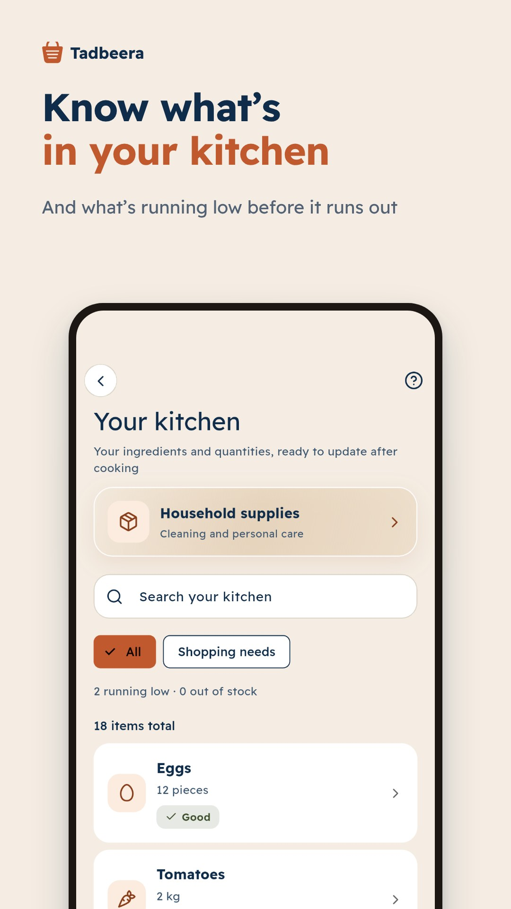 | 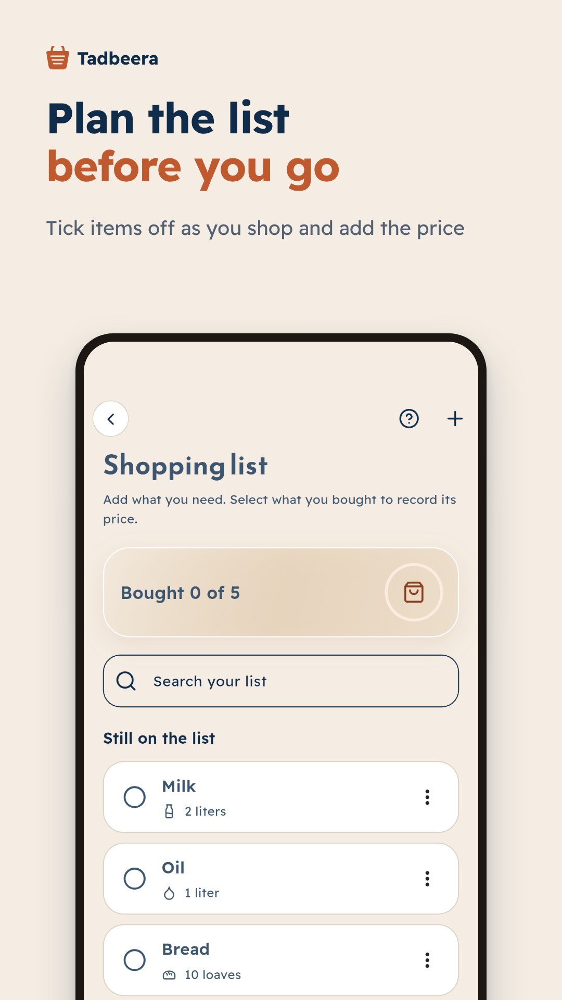 | 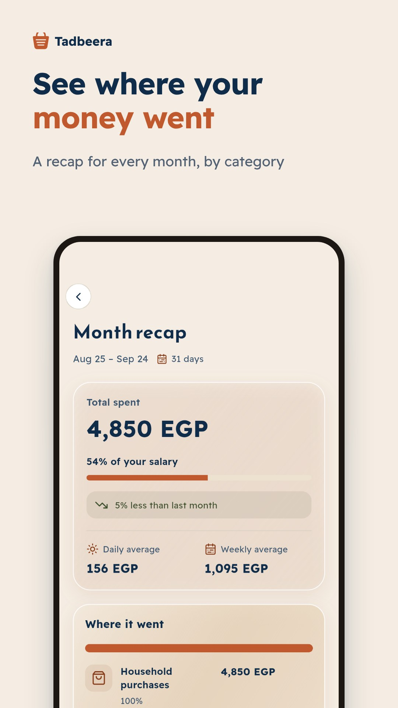 | 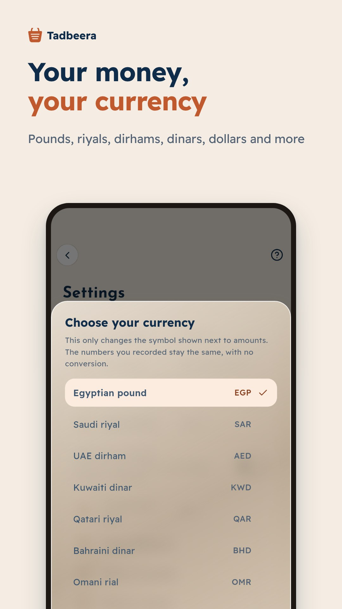 |

<strong>بالعربي</strong>

| | | |
|:---:|:---:|:---:|
| 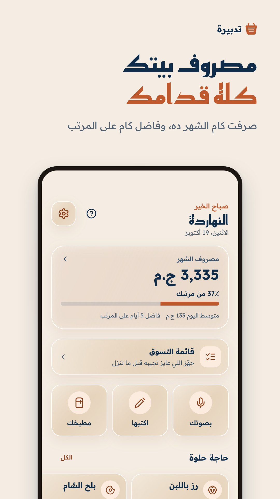 | 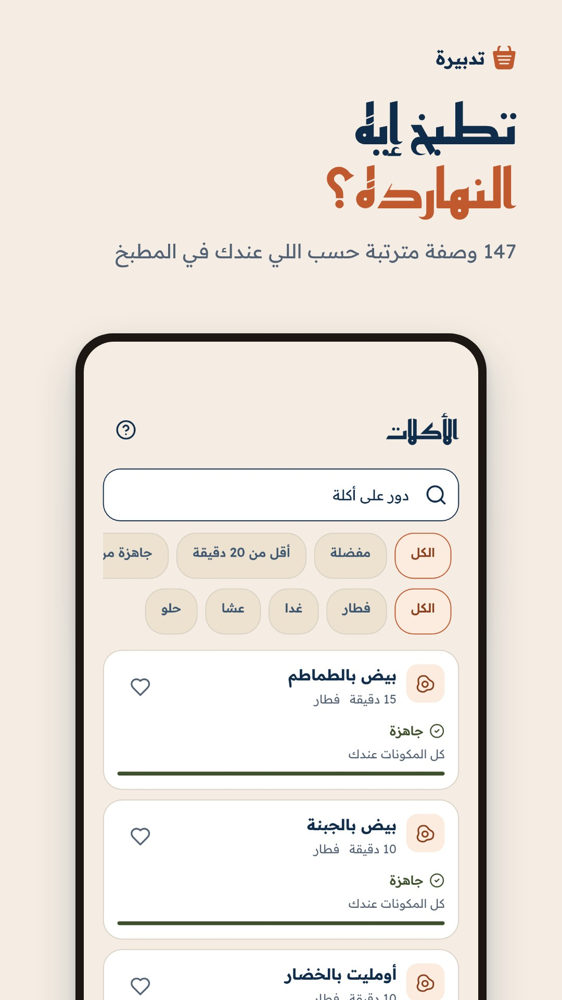 | 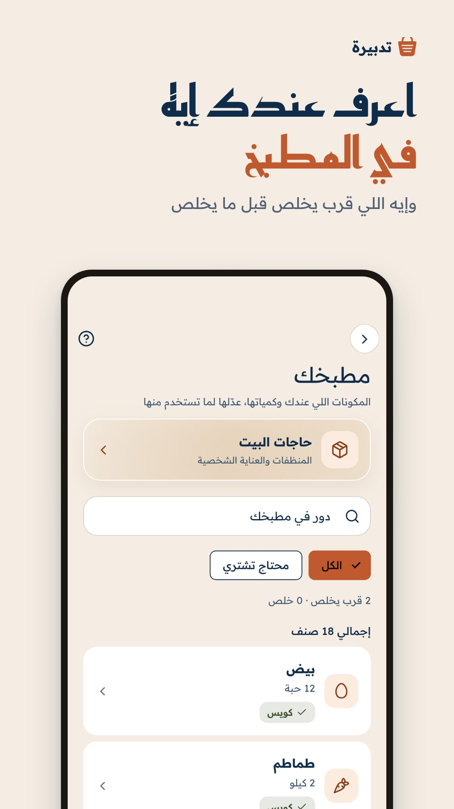 |

## Features

- **Voice and text entry.** Say "a kilo of tomatoes for 20 and eggs for 95" and it becomes separate items with prices and quantities.
- **Shopping list.** Plan before you go out, tick items off and add prices at the till.
- **Kitchen and household stock.** Updated from purchases, with low-stock alerts and a review step before deducting what you cooked.
- **159 recipes.** Egyptian, Levantine, Gulf and Maghrebi dishes sorted by what you have, with servings scaling and filters.
- **Spending.** Daily average, categories, a monthly recap and the share of your salary spent.
- **Bills.** Due dates, payments and local reminders.
- **Currencies.** Pounds, riyals, dirhams, dinars, dollars, euros and more.
- **Privacy.** No account needed, data stays on the phone, optional AES-256-GCM encrypted backup to the user's own Google Drive, and a biometric lock.

## How it's built

| Area | Choices |
|---|---|
| UI | Flutter, Material 3, a custom design system, Arabic (RTL) and English, light and dark themes |
| State and DI | Cubit (flutter_bloc), get_it with injectable, go_router |
| Data | Drift (SQLite) with schema migrations, Freezed models, SharedPreferences, flutter_secure_storage |
| Device | speech_to_text with a custom Arabic and English purchase parser, timezone-aware local notifications, local_auth |
| Cloud | Google Sign-In and the Drive API, limited to the `drive.file` scope, for backup and restore |
| Ads | Google Mobile Ads with the UMP consent SDK |
| Quality | 750+ unit, widget and integration tests, plus an automated tour that captures every screen in Arabic and English, light and dark |
| Process | Feature branches and pull requests, Play App Signing, a closed test with 12 testers before the Google Play release |

## Contact

Mostafa Akram · [LinkedIn](https://www.linkedin.com/in/mostafaakram-dev) · mostafaakram2004@gmail.com

---

© 2026 Mostafa Akram. All rights reserved. The Tadbeera name, logo, screenshots, design and content are not licensed for reuse. See [LICENSE](LICENSE).
